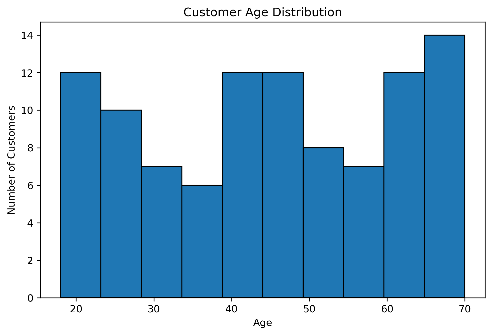
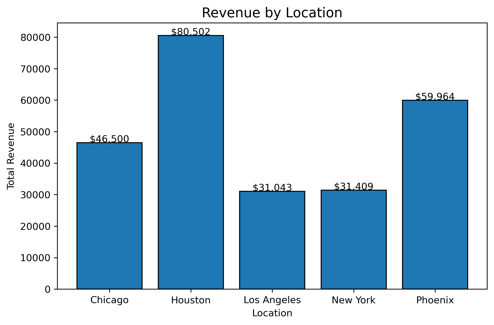
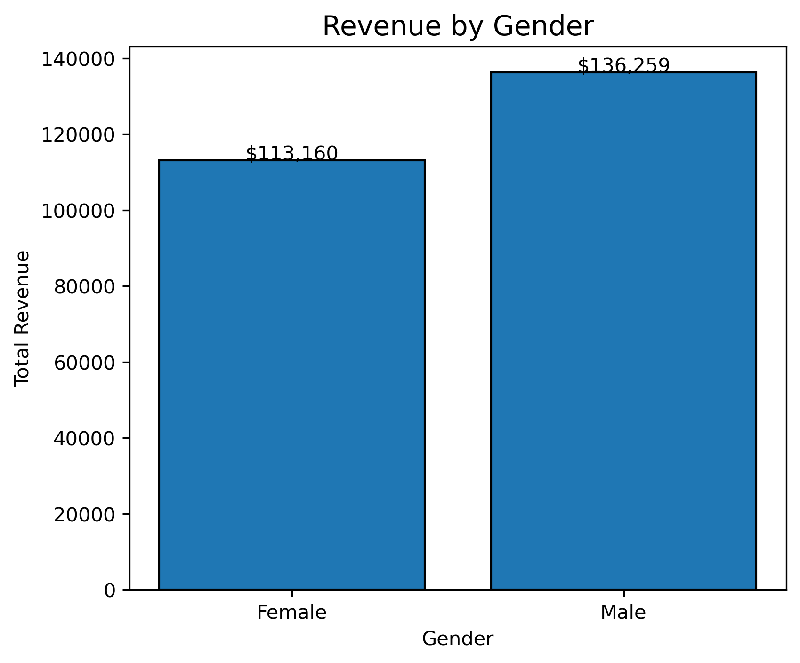
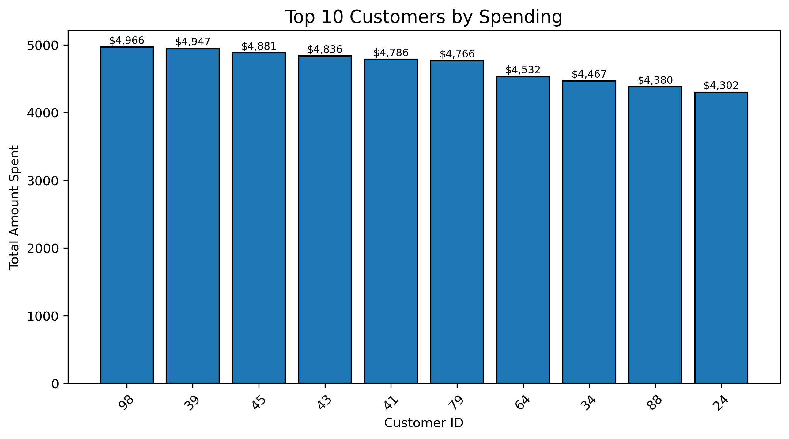
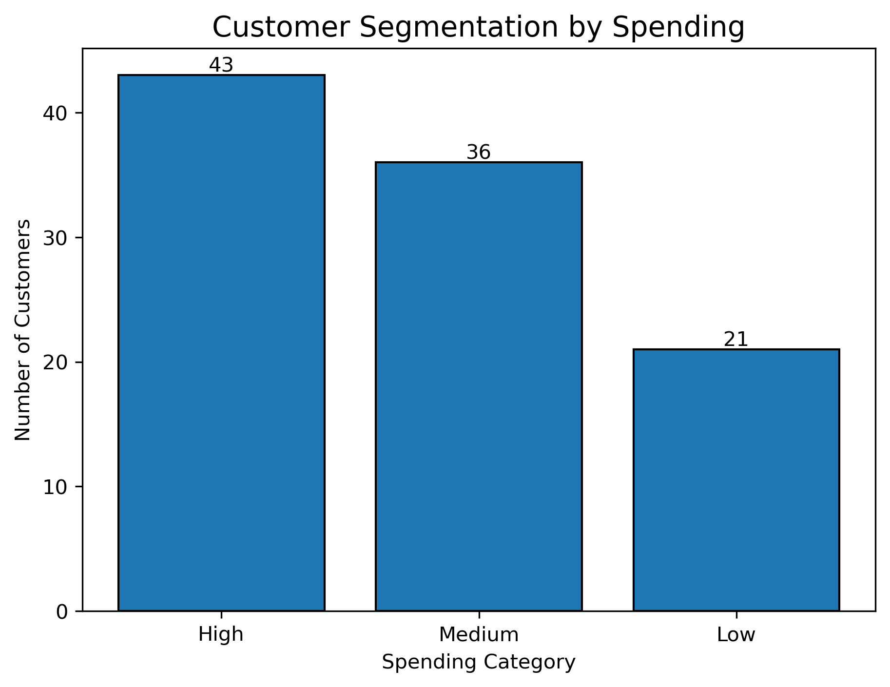

# 🛍️ Retail Customer Analysis using Python

A complete **Exploratory Data Analysis (EDA)** project built using **Python, Pandas, NumPy, and Matplotlib** to analyze customer demographics and purchasing behavior. This project transforms raw customer data into meaningful business insights through data cleaning, visualization, and storytelling.

---

# 🚀 Project Overview

This project demonstrates the complete Data Analysis workflow, including:

- ✅ Data Cleaning
- ✅ Exploratory Data Analysis (EDA)
- ✅ Data Visualization
- ✅ Customer Segmentation
- ✅ Business Insights
- ✅ Business Recommendations

---

# 🎯 Project Objective

The primary objectives of this project are:

- Understand customer demographics.
- Analyze customer spending behavior.
- Identify high-value customers.
- Compare revenue across different locations.
- Analyze revenue by gender and age group.
- Segment customers based on spending.
- Generate actionable business recommendations.

---

# 📂 Dataset Information

The dataset contains the following customer information:

| Column Name | Description |
|-------------|-------------|
| CustomerID | Unique customer identifier |
| Age | Customer age |
| Gender | Customer gender |
| Location | Customer location |
| TotalPurchases | Number of purchases |
| TotalAmountSpent | Total amount spent |
| LastPurchaseDate | Most recent purchase date |

---

# 🛠️ Technologies Used

| Technology | Purpose |
|------------|---------|
| Python | Programming Language |
| Pandas | Data Cleaning & Analysis |
| NumPy | Numerical Operations |
| Matplotlib | Data Visualization |
| Jupyter Notebook | Development Environment |

---

# 📊 Project Workflow

```text
Business Understanding
        ↓
Dataset Exploration
        ↓
Data Cleaning
        ↓
Exploratory Data Analysis (EDA)
        ↓
Data Visualization
        ↓
Business Insights
        ↓
Business Recommendations
```

---

# 📊 Project Visualizations

## Customer Age Distribution



---

## Revenue by Location



---

## Revenue by Gender



---

## Top 10 Customers by Spending



---

## Customer Segmentation



---

# 📈 Exploratory Data Analysis Performed

The following analyses were performed:

- Customer Age Distribution
- Gender Distribution
- Customer Distribution by Location
- Revenue by Location
- Revenue by Gender
- Revenue by Age Group
- Top 10 Customers by Spending
- Customer Segmentation by Spending

---

# 🌟 Project Highlights

- Performed complete Data Cleaning and Exploratory Data Analysis.
- Visualized customer demographics and purchasing behavior.
- Compared revenue across different locations.
- Analyzed revenue contribution by gender and age groups.
- Identified top spending customers.
- Segmented customers into Low, Medium, and High spenders.
- Generated business insights and recommendations.

---

# 💡 Key Business Insights

- Customer distribution varies across different locations.
- Some locations generate significantly higher revenue than others.
- Revenue contribution differs across customer demographics.
- A small percentage of customers contribute a large share of total revenue.
- Customer segmentation helps identify High, Medium, and Low-value customers.

---

# ✅ Business Recommendations

- Focus marketing efforts on high-revenue locations.
- Reward high-value customers through loyalty programs.
- Encourage medium spenders with personalized offers.
- Increase engagement of low spenders through promotional campaigns.
- Continuously monitor customer purchasing behavior for better business decisions.

---

# 📁 Project Structure

```text
Retail-Customer-Analysis/
│
├── README.md
├── Retail_Customer_Analysis.ipynb
├── customer_data.csv
├── requirements.txt
└── images/
    ├── age_distribution.png
    ├── gender_distribution.png
    ├── customer_distribution_by_location.png
    ├── revenue_by_location.png
    ├── revenue_by_gender.png
    ├── revenue_by_age_group.png
    ├── top10_customers.png
    └── customer_segmentation_bar.png
```

---

# 🚀 How to Run the Project

### Clone the repository

```bash
git clone https://github.com/NayanPangare/Retail-Customer-Analysis.git
```

### Navigate to the project directory

```bash
cd Retail-Customer-Analysis
```

### Install required libraries

```bash
pip install -r requirements.txt
```

### Launch Jupyter Notebook

```bash
jupyter notebook
```

### Open

```
Retail_Customer_Analysis.ipynb
```

Run all cells to reproduce the analysis.

---

# 💼 Skills Demonstrated

- Python Programming
- Data Cleaning
- Exploratory Data Analysis (EDA)
- Data Visualization
- Customer Segmentation
- Business Analysis
- Data Storytelling
- Business Recommendation Generation

---

# 👨‍💻 Author

**Nayan Pangare**


**Skills**

- Python
- Pandas
- NumPy
- Machine Learning
- Data Analysis

---

⭐ If you found this project useful, consider giving it a **Star** on GitHub!